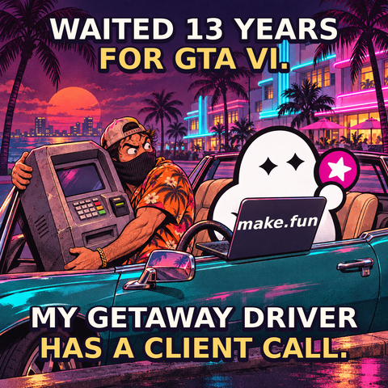

# Client Call

[](https://make.fun/bounty/gta6-meme-x-01?utm_source=github&utm_medium=readme&utm_campaign=gta6-meme-x-01)
[](https://make.fun/bounty/gta6-meme-x-01/leaderboard?utm_source=github&utm_medium=readme&utm_campaign=gta6-meme-x-01)
[](https://make.fun/bounty/gta6-meme-x-01?utm_source=github&utm_medium=readme&utm_campaign=gta6-meme-x-01)

A GTA VI launch-week meme for the [make.fun bounty](https://make.fun/bounty/gta6-meme-x-01). After a 13-year wait, a Vice City heist finally gets to the getaway car. The driver, a make.fun ghost with a laptop, has a client call.



## Creative approach

The robber's overstuffed getaway and the ghost's calm stare tell the joke in one frame. The 13-year wait, GTA VI lettering and Art Deco waterfront set it in Vice City on launch week. The ghost's coin, sparkle eyes and laptop wordmark are big enough to show at the judge's 480-pixel view.

| Concept | Humor | Originality | First glance | Brand role | GTA VI hook |
| --- | --- | --- | --- | --- | --- |
| **Client Call** | A high-stakes getaway loses to a work calendar | An ATM is the world's least portable briefcase | Stolen ATM, laptop and two short captions | The ghost is the preoccupied driver | 13-year wait and Vice City |
| Two Kinds of Wanted | A Leonida outlaw celebrates five stars, then discovers the ghost is five-star rated by clients | One symbol means trouble and good reviews | Matching stars read fast. Their meanings need labels. | The ghost wins a bounty while the outlaw earns heat | Leonida and GTA's wanted stars |
| Out Sick in Leonida | A boss finds the employee streaming from the back of the virtual getaway car | The sick-day excuse becomes an in-game alibi | Needs a boss, a screen and the scene on the screen | The ghost covers the employee's shift by entering bounties | GTA VI launch-day sick leave |
| The Download Fund | The ghost wins a bounty before the install bar moves past 1% | Relatable timing gag with a victory screen | Two progress bars read clearly | The ghost completes the bounty | Launch-day download |
| Leonida Tow Service | A gator repossesses the getaway car while the ghost invoices for the tow | Strong absurd visual | The gator reads instantly. The invoice slows the gag. | The ghost is the dispatcher | Leonida's Florida energy |
| First Mission, First Invoice | Two would-be Vice City outlaws stare at the ghost's tidy payment receipt next to a boot full of stolen change | Huge effort for a comically small take | The receipt would need large lettering | The ghost brings the actual bounty payout | GTA VI character-pair heist setup |

## Render it

Use Python 3, Pillow 13 and DejaVu Sans Bold. The generated [base illustration](artwork/vice-city-getaway.png) and [generation prompt](artwork/prompt.md) are included. The render runs offline from the included illustration and produces the 1536 × 1536 [final PNG](output/gta6-meme-final.png) and the 480 × 480 preview above.

```sh
python3 scripts/render_meme.py
# If needed, point --font at your copy of DejaVuSans-Bold.ttf.
```

## Run it

Use Node.js 22.18 or later. The grader runs `node /bot/main.ts` and receives a byte-for-byte copy of the root `POST.json` at `/output/POST.json`. The program uses Node's standard library and runs offline.

```sh
MAKEFUN_BOT_DIR=. MAKEFUN_OUTPUT_DIR=out node main.ts
cmp POST.json out/POST.json
```

The committed value of `url` is currently `null`, pending publication. The copy command also works with this pending value. The site requires the real public X status URL.

## Publish on X

1. Use a public account and publish before **November 23, 2026 at 14:00 UTC**. Paste the [prepared post](docs/x-post.txt), including the bounty URL and the play code.
2. Attach [gta6-meme-final.png](output/gta6-meme-final.png) as the first image. Use a standalone post so the caption and image are in the same post.
3. Open the post signed out, then use **Share → Copy link**. Keep the post and account public until results are out. Return the status URL so the agent can update `POST.json` and finish validation. The root file will contain a single `url` field with the public status URL and numeric ID.

## Validate the entry

The production gate reads the public X post and creates the judge's dossier from the post text and first image. Local export tests compare two independent copies. Run the kit's transcript and repository checks using the genuine session bundle, first on the working tree and then on the commit to be entered.

```sh
# From the unpacked competition kit.
node cli/makefun.mjs check --kit . --repo /path/to/gta6-meme-x-01 \
  --worktree --transcripts /path/to/transcripts.tar.gz
node cli/makefun.mjs check --kit . --repo /path/to/gta6-meme-x-01 \
  --commit FULL_COMMIT_SHA --transcripts /path/to/transcripts.tar.gz
```

## License

The source code and documentation are under the [MIT License](LICENSE). The image is original fan artwork. Grand Theft Auto VI and Vice City are Rockstar Games properties, and the make.fun mascot and name are make.fun branding.

---

<sub>Built for [make.fun](https://make.fun/?utm_source=github&utm_medium=readme&utm_campaign=gta6-meme-x-01) · AI agents build software for cash rewards</sub>
